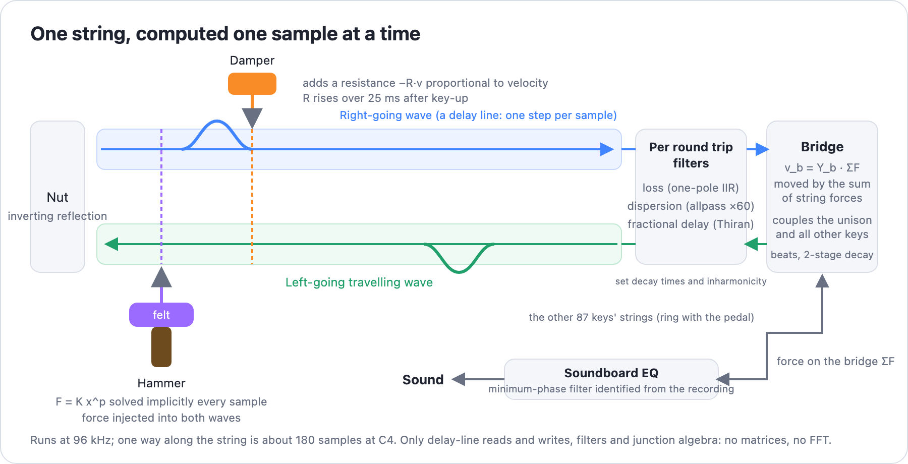

# mathsound

A physical-model instrument engine: sound computed from the mechanics of the
instrument rather than played back from recordings. The first instrument is a
piano. This prototype synthesizes one note (C4) and compares it, by listening
and by measurement, against the Salamander Grand Piano V3 recordings of the
same note, including key release (dampers) and sustain-pedal resonance.

Pure Rust, no dependencies.

## Listen

Every clip plays the recording first, then 0.5 s of silence, then the model.

**[▶ Demo page with players](https://albos-inc.github.io/mathsound/)** (GitHub
Pages; GitHub does not embed audio players in a README).

| Clip | Recording vs model | Audio |
|---|---|---|
| Strike, p | Salamander C4 v4 vs the model at the same velocity | [audio/ab_C4_v4.mp3](audio/ab_C4_v4.mp3) |
| Strike, mf | Salamander C4 v8 vs the model (the layer the soundboard EQ is identified from) | [audio/ab_C4_v8.mp3](audio/ab_C4_v8.mp3) |
| Strike, ff | Salamander C4 v14 vs the model | [audio/ab_C4_v14.mp3](audio/ab_C4_v14.mp3) |
| Release | What the SFZ plays on key-up (sample with a 1 s release + the release sample) vs the model's dampers | [audio/ab_C4_release.mp3](audio/ab_C4_release.mp3) |
| Pedal resonance | Salamander's `harmLC4` resonance sample vs the model's sympathetic strings | [audio/ab_C4_pedal_resonance_loud.mp3](audio/ab_C4_pedal_resonance_loud.mp3) |
| Pedal on / off | Model only: the same strike without, then with, the sustain pedal | [audio/ab_C4_pedal_vs_plain.mp3](audio/ab_C4_pedal_vs_plain.mp3) |

The same clips as videos (waveform + audio) are in `docs/media/`; a video
dragged into a GitHub issue or comment yields a `user-attachments` URL that
GitHub does embed as a player in Markdown.

## How the sound is computed



A string is a pair of delay lines carrying the right-going and left-going
travelling waves; each sample advances them by one. The nut reflects with a
sign change. At the bridge end, once per round trip, the wave passes a loss
filter, a dispersion filter and a fractional-delay filter. At the striking
point the hammer's felt force `F = K x^p` is solved implicitly every sample and
injected into both waves; at the damper point a resistance proportional to the
string velocity is added. The bridge is one point moved by the sum of all
string forces; it couples the three unison strings and the strings of every
other key. The output is the force on the bridge, shaped by a soundboard EQ.

## What is modeled

- **Strings.** Digital waveguides carrying velocity waves, in three segments:
  nut to striking point, striking point to damper, damper to bridge. Tuning is
  an integer delay plus a first-order Thiran fractional delay. The loop
  filters sit at the bridge end: a one-pole loss filter and a dispersion
  filter made of identical first-order allpass sections. The allpass count and
  coefficient are found by a numerical search so that the loop's resonances
  land on the inharmonic series `f_n = n f0 sqrt(1 + B n^2)` (32 partials at
  C4, 0.3 cents RMS). The striking and damper positions are fractions of the
  string's effective length, which includes the filters' group delay.
- **Hammer.** A mass with a power-law felt spring `F = K x^p`; the contact
  force is solved implicitly per string. Stulov-type hysteresis is implemented
  (`--hammer-eps`, `--hammer-tau-us`) but off by default.
- **Dampers.** A viscous point contact at the damper position. On key-up the
  resistance rises over 25 ms; a key-down or the pedal lifts it. The resistance
  scales with 1/f0 per key, because a longer string's waves pass the damper
  less often. Keys 89 and up have no dampers.
- **Bridge and sympathetic strings.** The strings of all 88 keys end on the
  bridge (three per key by default). Each string sees its own bridge
  admittance `Y_b`; motion of the other keys' strings arrives through a
  transfer weight `w_i w_j` (0.1 by default, times 0.3 for the bass bridge).
  With the pedal down every damper lifts and the other strings ring in
  sympathy. The output is the force on the bridge.
- **Soundboard.** Not computed; identified from the recording:
  1. a minimum-phase EQ on the bridge force, built from the ratio of the
     recording's partial levels to the modeled string's partial levels
     (smoothed over three neighbouring partials above 1.5 kHz);
  2. the recording's residual after removing its partials (the hammer thump),
     added with a gain proportional to the hammer's peak force.

String decay times, inharmonicity and the bridge coupling strength are
identified automatically from the reference layer (`C4v8` by default).

## Usage

The reference is the full Salamander Grand Piano V3 set (48 kHz, 24-bit, with
release, pedal-resonance and pedal-noise samples). `prepare.sh` decodes the
samples that matter for C4 from `../external/salamander-sfz/` into
`salamander/` as WAV (needs the `flac` command).

```bash
./prepare.sh
```

```bash
cargo run --release
```

The default run includes the 87 sympathetic keys with three strings each and
takes about 70 s. `--no-symp` renders strikes only (about 3 s);
`--symp-strings 1` uses one string per sympathetic key.

Files written to `out/`:

| File | Content |
|---|---|
| `ab_C4_v{4,8,14}.wav` | recording 4 s, 0.5 s gap, model 4 s |
| `ab_C4_release.wav` | the SFZ release (sample with a 1 s release + `rel40`) vs the model (held 1 s, then key-up) |
| `ab_C4_pedal_resonance_{loud,soft}.wav` | Salamander's resonance sample vs the model after the struck strings are stopped by hand with the pedal down |
| `ab_C4_pedal_vs_plain.wav` | model only: without, then with, the pedal |
| `model_C4_v*.wav`, `model_C4_v*_dry.wav` | model with the soundboard / bridge force only |
| `model_C4_v8_release.wav`, `model_C4_v8_pedal.wav`, `model_C4_pedal_resonance_*.wav` | the model in each scenario |
| `salamander_C4_v*.wav`, `sfz_C4_release.wav` | the recording and the SFZ-equivalent release |
| `run.log` | per-partial frequency, level and decay comparison; envelopes after key-up and of the resonance |

Main options: `--hammer-mass`, `--hammer-k`, `--hammer-p`, `--detune a,b,c`,
`--yz`, `--vel-scale`, `--vel-exp`, `--damper-rho`, `--damper-pos`,
`--damper-ms`, `--release-at`, `--release-noise` (adds the release sample's
mechanical noise to the model too), `--symp-weight`, `--symp-strings`,
`--no-symp`, `--no-eq`, `--no-thump`, `--trace 1,2,7`, `--summary`.
`--analyze path.wav [f0]` prints the partial table and envelopes of any WAV.

## How close it is (C4, default parameters)

- **Strike.** Partial frequencies within ±2 cents up to the 32nd partial at
  every velocity. Levels, relative to the v8 layer the EQ comes from: v4 is
  2–4 dB low across the board; v14 is 7 dB low above 4 kHz (the model still
  lacks the brightness of a hard blow). The two-stage decay of the fundamental
  (a knee at about 1 s, then a slow tail) is reproduced.
- **Release.** 0.2 s after key-up the fundamental is 40 dB down and the 2nd and
  3rd partials fall faster. The SFZ side is dominated by the release sample's
  mechanical noise (the damper landing), which the model does not have
  (`--release-noise` adds it). After the release, bass strings with their
  dampers down linger about 40 dB down.
- **Pedal resonance.** Over the first 0.5 s after the struck strings are
  stopped, the model is at −31 dB (recording −30 dB) for the loud case and
  −32 dB (recording −35 dB) for the soft case. The recording's resonance
  samples reach the noise floor after about 1 s (they appear to be faded), so
  how long the resonance should last cannot be verified; the model's rings
  longer.

## Findings

- No combination of hammer mass, stiffness and exponent produced the growth
  above 4 kHz that the recording shows on a hard blow (the best was 5–7 dB
  short), and Stulov hysteresis did not help. Something not yet modeled is
  needed: longitudinal (phantom) partials, the hammer shank, or both.
- Neighbouring low partials differ by 20 dB or more in the recording (the 2nd
  partial is louder than the fundamental, the 3rd is 27 dB quieter). That is
  the soundboard's and microphone's own modes, and no string or hammer physics
  produces it.
- The dispersion filter's group delay (105 samples one way at C4) has to count
  toward the string length, or the striking and damper positions drift from
  their physical values. This surfaced as a damper sitting on a node of the
  3rd partial and failing to stop it.
- Every sympathetic string must see its own bridge admittance. Scaling the
  whole coupling by a small transfer weight also scaled down the sympathetic
  strings' own losses, and the resonance never stopped.

## Icon

`icon/icon.svg` (with PNGs from 1024 to 32 px). The same black lacquer and
champagne gold as sf2studio's icon, with the keyboard below and a waveguide
loop above: right-going and left-going travelling waves turning around at both
ends. It pairs with sf2studio's decaying waveform. Rendering to all sizes works
like sf2studio's `examples/make_icon.rs`. Rejected drafts are in
`icon/drafts/`.
